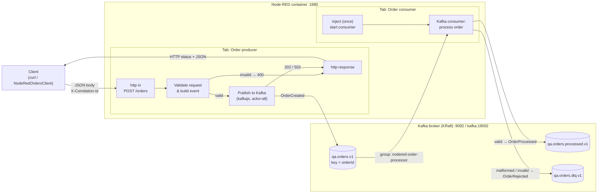
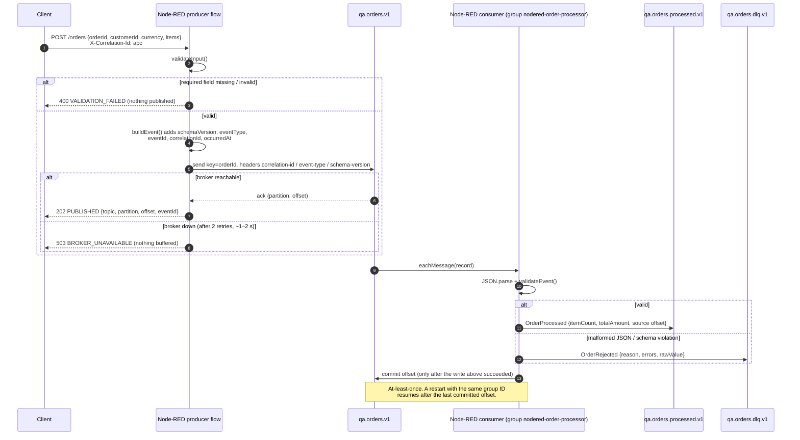
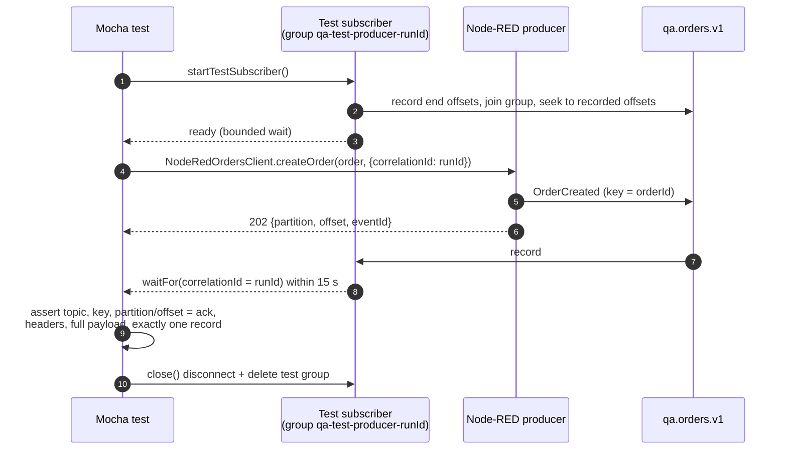
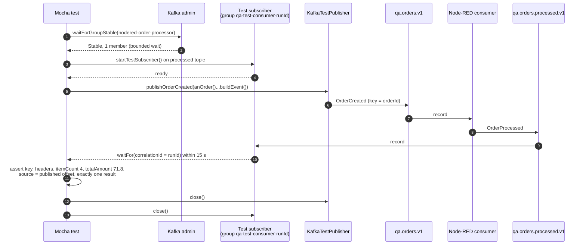
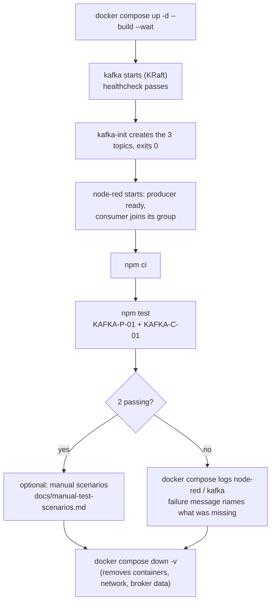

# End-to-end workflow and code structure guideline

Part A walks through one order from the HTTP request to the downstream result, how each automated test
drives that path, and how CI runs it. Part B is the code structure guideline: folder layout, what each
layer is for, and the naming and coding conventions to follow when adding a test. The diagrams are Mermaid; GitHub, GitLab and
VS Code (with a Mermaid extension) render them.

# Part A: End-to-end workflow

## 1. Components



The event rules (required fields, envelope, totals) live in one module,
`node-red/lib/order-event.js`, and both tabs use it.

## 2. Runtime path of one order



In words:

1. **Request:** the client POSTs an order. The correlation ID comes from the `X-Correlation-Id`
   header, then `body.correlationId`; if neither is set, a new UUID is used.
2. **Validate:** a missing or invalid field returns `400` straight away, and nothing reaches Kafka.
3. **Publish:** the producer wraps the order in the OrderCreated v1 envelope and sends it with
   key = `orderId` and `acks=all`. A broker ack gives `202` with the partition and offset. If the
   broker is unreachable after the configured retries, the client gets `503`.
4. **Consume:** the long-lived consumer reads `qa.orders.v1` with group `nodered-order-processor`.
5. **Process:** a valid event becomes **OrderProcessed** (item count, total, link back to the source
   offset) on `qa.orders.processed.v1`. Bad input becomes **OrderRejected** on the dead-letter topic,
   and the consumer moves on to the next record.
6. **Commit:** the offset is committed only after step 5's write succeeds, so a crash never skips a record.

## 3. How the automated tests drive the flow

Each test covers one half of the path, with an independent Kafka client as the oracle. Each run gets
a unique `runId`, which is used as the correlation ID, inside the order ID, and in the test's own
consumer group name.

### KAFKA-P-01: producer test (`test/producer.int.test.js`)



### KAFKA-C-01: consumer test (`test/consumer.int.test.js`)



The two tests are independent: either can run alone (`npm run test:producer`,
`npm run test:consumer`) or both together (`npm test`).

## 4. Full run, from start to shutdown



## 5. CI run (GitHub Actions, `ci/github-actions-e2e.yml`)

```mermaid
flowchart LR
    T["push to main / pull request /<br/>manual run"] --> A["checkout"]
    A --> B["setup Node 22<br/>(npm cache)"]
    B --> C["npm ci"]
    C --> D["npm run lint<br/>ESLint + Prettier"]
    D --> E["npm run test:unit<br/>contract rules, ~10 ms"]
    E --> E2["npm run test:bdd:dry<br/>Gherkin steps defined"]
    E2 --> F["docker compose up<br/>-d --build --wait"]
    F --> G["npm test<br/>Gherkin + Mocha, P-01 + C-01 vs real broker"]
    G --> H["docker compose down -v<br/>(always)"]
    G -. failure .-> L["upload compose-logs<br/>artifact (7 days)"]
    L --> H
```



Cheap checks run first (fail fast). The real stack starts only once lint and unit tests pass, and it is
torn down even when a step fails.

## 6. Where each scenario sits on the path

| Step on the path | Scenario | Automated |
|---|---|---|
| Request → publish (happy path) | KAFKA-P-01 | yes, `producer.int.test.js` |
| Request rejected before Kafka | KAFKA-P-02 | manual |
| Publish while broker down | KAFKA-P-03 | manual |
| Consume → OrderProcessed | KAFKA-C-01 | yes, `consumer.int.test.js` |
| Consume malformed → DLQ, then continue | KAFKA-C-02 | manual |
| Consumer restart → resume from committed offset | KAFKA-C-03 | manual |

---

# Part B: Code structure guideline

## 7. Folder layout and what each layer does

```
PROJECT FILES/
├─ docker-compose.yml          # Environment: broker, topic init, Node-RED. Nothing test-specific.
├─ node-red/                   # SYSTEM UNDER TEST
│  ├─ flows.json               #   producer + consumer flows (importable)
│  ├─ lib/order-event.js       #   the event contract: validation, envelope, result. Single source of truth.
│  ├─ settings.js              #   exposes kafkajs + contract to function nodes
│  └─ Dockerfile, package.json #   reproducible image (pinned versions)
├─ features/                   # GHERKIN: *.feature (all 6 scenarios), step_definitions/, support/ (World, hooks)
├─ test/                       # TEST CODE (never imported by the system under test)
│  ├─ *.int.test.js            #   L1 specs: one file per automated scenario, named after its manual ID
│  ├─ unit/*.test.js           #   L1 specs that need no broker (contract rules)
│  ├─ clients/                 #   L2 client objects: one per external interface
│  ├─ fixtures/                #   L3 test data builders
│  └─ support/                 #   L4 config + generic helpers (run IDs, timeouts)
├─ docs/                       # manual scenarios, schema, this guide
├─ ci/github-actions-e2e.yml   # CI pipeline (copy to .github/workflows/ on GitHub)
└─ eslint.config.js, .prettierrc.json, .editorconfig, .nvmrc   # code style + Node version
```

| Layer | Folder | Its job | It must not |
|---|---|---|---|
| L1 Specs | `test/*.int.test.js`, `test/unit/` | State the scenario: Arrange, Act, Assert. Hold the expected values. | Build raw HTTP requests or kafkajs messages, or hard-code URLs and topics. |
| L2 Client objects | `test/clients/` | Hide *how* to talk to an interface (HTTP, kafkajs), handle readiness, and close cleanly. | Contain assertions or scenario-specific data. |
| L3 Fixtures | `test/fixtures/` | Produce valid default data that a spec can override (`anOrder().withCurrency('EUR')`). | Reuse system-under-test code to compute expected results. |
| L4 Support | `test/support/` | Config from env vars (validated), `newRunId()`, `withTimeout()`. | Know about orders, Kafka topics' meaning, or Node-RED. |

Dependencies only point downward: specs → clients/fixtures → support. Clients never import specs, and
nothing in `node-red/` imports from `test/`. The one sanctioned exception is `test/unit/`, which imports
`node-red/lib/order-event.js` because that module *is* what it tests.

## 8. Naming conventions

| Thing | Convention | Example |
|---|---|---|
| Integration spec file | `<area>.int.test.js` | `producer.int.test.js` |
| Unit spec file | `test/unit/<module>.test.js` | `order-event.test.js` |
| `describe` title | flow direction + `[manual ID]` | `Node-RED producer -> Kafka [KAFKA-P-01]` |
| `it` title | observable behaviour, present tense | `publishes the OrderCreated event ... with key = orderId` |
| Manual scenario ID | `KAFKA-<P\|C>-NN` | `KAFKA-C-03` |
| Client object | `<Target><Role>` class, file `kebab-case` | `NodeRedOrdersClient` in `node-red-orders.client.js` |
| Client method | verb + domain noun | `createOrder()`, `publishOrderCreated()`, `waitFor()` |
| Builder | `a<Noun>()` + `with<Field>()` / `without()` / `build<Shape>()` | `anOrder().without('customerId').buildRequest()` |
| Run ID / correlation ID | `it-<area>-<epoch>-<uuid8>` via `newRunId()` | `it-consumer-1794522387306-8ab068a3` |
| Test consumer group | `qa-test-<area>-<runId>` | `qa-test-producer-it-producer-…` |
| Topics | `<domain>.<entity>[.<stage>].v<N>` | `qa.orders.processed.v1` |
| Constants | `UPPER_SNAKE_CASE`, named for meaning | `DEFAULT_WAIT_MS`, `CURRENCY_PATTERN` |
| Env vars | `UPPER_SNAKE_CASE`, same name in compose and tests | `KAFKA_BROKERS`, `TEST_WAIT_MS` |

## 9. Coding conventions (checklist for every new test)

**Isolation and repeatability**
- [ ] Each run creates its own `runId` and uses it as the correlation ID, in the business key, and in the test's consumer group name.
- [ ] Match records by correlation ID, never by "the latest message on the topic".
- [ ] Each spec file runs alone (`npx mocha test/<file>`) and in any order with the others.

**Synchronisation**
- [ ] Subscribers are ready (group joined and positioned) **before** anything is published.
- [ ] For a consumer under test, wait for its group to be `Stable` before publishing.
- [ ] Every wait is bounded (`config.waitMs`) and its failure message names what was missing. No `sleep()`.

**Assertions**
- [ ] Assert on topic, key, headers and the full payload, not just "a message arrived".
- [ ] Expected values are literals written in the spec (`totalAmount: 71.8`). Never recompute them with the code under test.
- [ ] Check "exactly one" for this run, to catch duplicates.
- [ ] Pass a message to `expect(actual, message)` when the default output wouldn't explain the failure (for example, include the HTTP body).

**Cleanup**
- [ ] Every client opened in `before` is closed in `after`, with `.catch(() => {})` so cleanup never hides the real failure.
- [ ] Delete test consumer groups. Mocha runs without `--exit`, so a leaked client shows up as a hanging run.

**Configuration**
- [ ] No hard-coded hosts, ports, topics or timeouts in specs. Read them from `config`, which reads env vars and validates them.
- [ ] Pin dependency versions (exact versions in `package.json`, and a committed `package-lock.json`).

**Style**
- [ ] `npm run lint` passes (ESLint recommended rules, `eqeqeq`, `prefer-const`, `no-var`, Prettier).
- [ ] ES modules in `test/`, CommonJS in `node-red/` (Node-RED requirement).
- [ ] Comments explain *why* (for example "On Stop is not awaited by Node-RED"), not *what*.

## 10. Adding a new automated scenario (worked recipe)

Example: automate **KAFKA-C-02** (malformed event goes to the DLQ, and the next valid event is still processed).

1. Write or confirm the manual scenario in `docs/manual-test-scenarios.md`, and take its ID.
2. Create `test/consumer-dlq.int.test.js` with `describe('... [KAFKA-C-02]')`.
3. Add `dlqTopic` to `test/support/config.js` (env var `DLQ_TOPIC`, default `qa.orders.dlq.v1`).
4. Add `publishRaw(key, text)` to `KafkaTestPublisher` for the malformed record. Keep the method generic, with no assertions.
5. In `before`: wait for the Node-RED group to be Stable, then start **two** subscribers (DLQ and processed), each with its own run-unique group.
6. Act: publish the malformed record, then `anOrder().withCorrelationId(runId).buildEvent()`.
7. Assert: one DLQ record with `reason: 'INVALID_JSON'` and the right source offset; one OrderProcessed for `runId` at offset + 1.
8. Close everything in `after`, then run `npm run lint`, the file on its own, then `npm test`.
9. Mark the scenario as automated in section 6 of this guide and in the README table.
