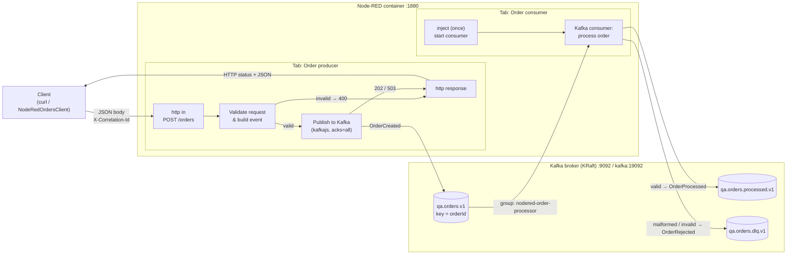
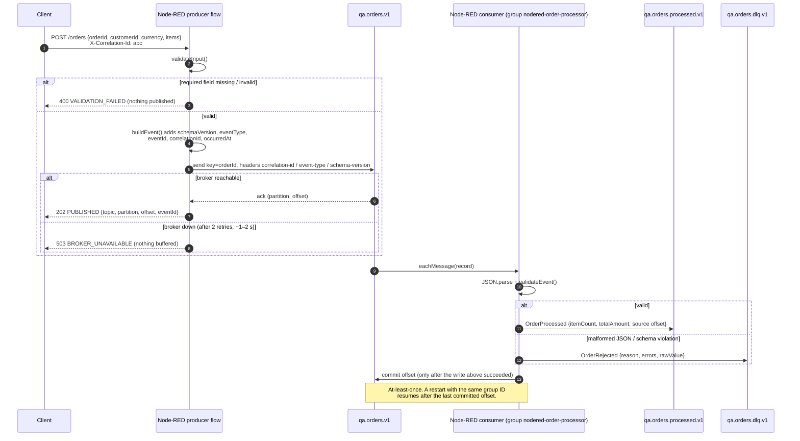
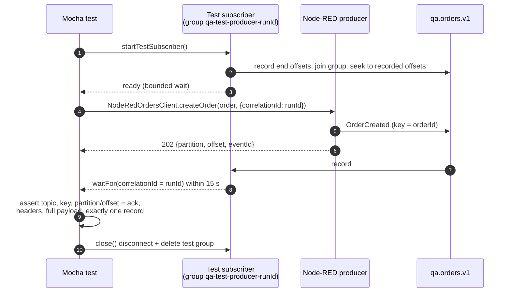
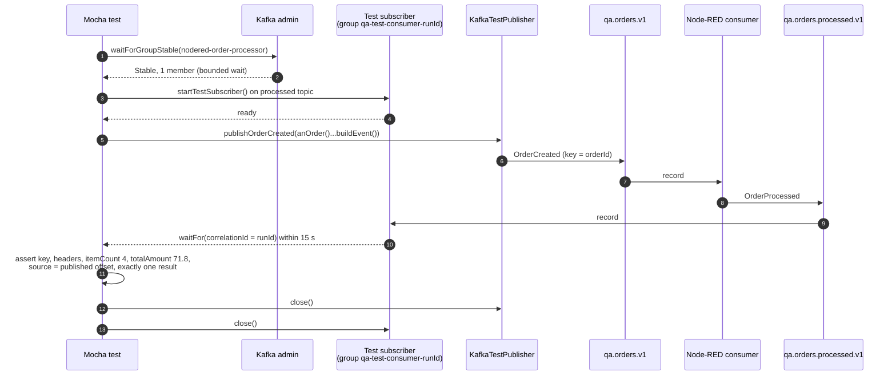
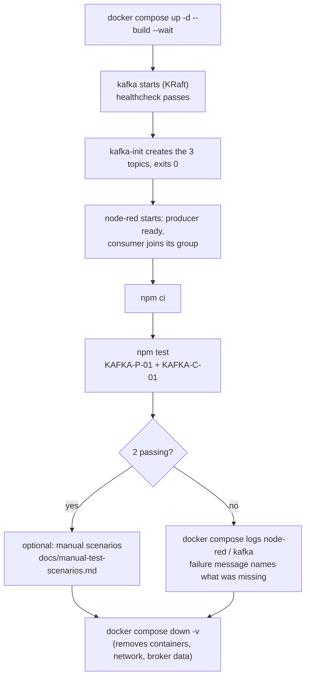

# End-to-end workflow

This page walks through one order from the HTTP request to the downstream result. It then shows how
each automated test drives that path and what it checks. The diagrams are Mermaid; GitHub, GitLab and
VS Code (with a Mermaid extension) render them.

## 1. Components

The event rules (required fields, envelope, totals) live in one module,
`node-red/lib/order-event.js`, and both tabs use it.

## 2. Runtime path of one order

In words:

1. **Request:** the client POSTs an order. The correlation ID comes from the `X-Correlation-Id`
   header, then `body.correlationId`; if neither is set, a new UUID is used.
2. **Validate:** a missing or invalid field returns `400` straight away, and nothing reaches Kafka.
3. **Publish:** the producer wraps the order in the OrderCreated v1 envelope and sends it with
   key = `orderId` and `acks=all`. A broker ack gives `202` with the partition and offset. If the
   broker is unreachable after the configured retries, the client gets `503`.
4. **Consume:** the long-lived consumer reads `qa.orders.v1` with group `nodered-order-processor`.
5. **Process:** a valid event becomes **OrderProcessed** (item count, total, link back to the source
   offset) on `qa.orders.processed.v1`. Bad input becomes **OrderRejected** on the dead-letter topic,
   and the consumer moves on to the next record.
6. **Commit:** the offset is committed only after step 5's write succeeds, so a crash never skips a record.

## 3. How the automated tests drive the flow

Each test covers one half of the path, with an independent Kafka client as the oracle. Each run gets
a unique `runId`, which is used as the correlation ID, inside the order ID, and in the test's own
consumer group name.

### KAFKA-P-01: producer test (`test/producer.int.test.js`)

### KAFKA-C-01: consumer test (`test/consumer.int.test.js`)

The two tests are independent: either can run alone (`npm run test:producer`,
`npm run test:consumer`) or both together (`npm test`).

## 4. Full run, from start to shutdown

## 5. Where each scenario sits on the path

| Step on the path | Scenario | Automated |
|---|---|---|
| Request → publish (happy path) | KAFKA-P-01 | yes, `producer.int.test.js` |
| Request rejected before Kafka | KAFKA-P-02 | manual |
| Publish while broker down | KAFKA-P-03 | manual |
| Consume → OrderProcessed | KAFKA-C-01 | yes, `consumer.int.test.js` |
| Consume malformed → DLQ, then continue | KAFKA-C-02 | manual |
| Consumer restart → resume from committed offset | KAFKA-C-03 | manual |
